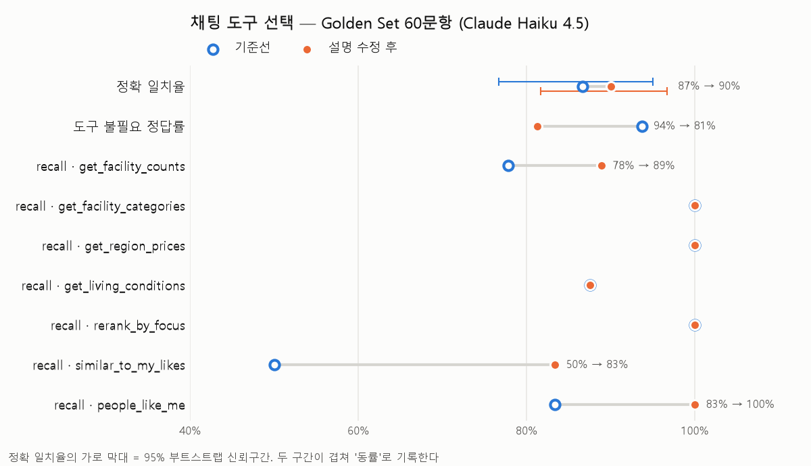

# 채팅 도구 선택 평가

## 도구 선택 정확도 (Function Calling) — 2026-10-13

- **왜**: 채팅 Planner(`chat_plan_node`)가 도구 7종 중 맞는 것을 고르는지 잴 방법이 없었다.
  도구를 잘못 고르면 답이 아무리 매끄러워도 근거가 틀린다.
- **무엇을**
  - `data/golden/tool_select.csv` — Golden Set 60문항. 도구별 6~9문항, 도구 불필요 16문항
    (비회원이 회원 전용 기능을 묻는 3문항 포함), 도구 2개 6문항, 동네 비교 2문항.
  - `pipeline/golden_tools.py` — 실제 경로인 `chat_plan_node()`를 그대로 불러 고른 도구 이름을 모은다
    (도구는 실행하지 않아 DB를 안 읽는다). 정확 일치율(+95% 부트스트랩 구간), 도구별 precision/recall,
    도구 불필요 정답률, 회원 전용 도구 오용 건수, 2회 실행 불일치율, 혼동 표를 낸다.
  - `tests/test_golden_tools.py` — 채점 함수만 검사한다(Claude 호출 없음).
  - `app/tools/tools.py` — 기준선에서 틀린 유형에 맞춰 도구 description 6개를 한 번 고쳤다.
- **실행**: `py -m pipeline.golden_tools --twice` (Claude 120번 호출 — 요금이 들어 CI에는 넣지 않는다)

### 측정

조건: 같은 60문항, Claude Haiku 4.5(`claude-haiku-4-5-20251001`), 대화 기록 없음, 추천 동네 5곳 고정.
기준선과 개선 후 모두 `--twice`로 두 번 돌렸다.

| 지표 | 기준선 | description 수정 후 |
|---|---|---|
| 정확 일치율 (95% CI) | 86.7% (76.7–95.0%) | 90.0% (81.7–96.7%) |
| 도구 불필요 정답률 | 93.8% (15/16) | **81.2% (13/16)** |
| 회원 전용 도구 오용 | 0건 | 0건 |
| 2회 실행 불일치율 | 0.0% | 0.0% |
| `get_facility_counts` P / R | 100% / 78% | 80% / 89% |
| `get_facility_categories` P / R | 75% / 100% | 75% / 100% |
| `get_region_prices` P / R | 90% / 100% | 90% / 100% |
| `get_living_conditions` P / R | 100% / 88% | 100% / 88% |
| `rerank_by_focus` P / R | 100% / 100% | 100% / 100% |
| `similar_to_my_likes` P / R | 75% / 50% | 100% / 83% |
| `people_like_me` P / R | 100% / 83% | 100% / 100% |

**판정: 동률.** 정확 일치율이 52 → 54문항으로 올랐지만 두 신뢰구간이 겹친다.
회원 도구의 recall은 확실히 올랐고, 그 대신 도구가 필요 없는 질문에도 도구를 부르는 일이 늘었다.

### 혼동 (기대 → 실제)

| 기대 | 실제 | 기준선 | 수정 후 |
|---|---|---|---|
| `similar_to_my_likes` | (없음) | 3 | 1 |
| `get_facility_counts` | `get_facility_categories` | 2 | 1 |
| `people_like_me` | `similar_to_my_likes` | 1 | 0 |
| `get_living_conditions` | (없음) | 1 | 1 |
| (없음) | `get_region_prices` | 1 | 1 |
| (없음) | `get_facility_counts` | 0 | 2 |
| (없음) | `get_facility_categories` | 0 | 1 |

### 틀린 유형과 수정

| 유형 | 기준선에서 틀린 문항 | 수정한 description | 결과 |
|---|---|---|---|
| "찜"을 좋아요로 못 알아봄 | 찜한 곳이랑 비교하면 어때? 외 2 | 찜·찜 목록도 좋아요와 같다, 비교·닮은 곳 어느 쪽이든 이 도구 | 3 → 1 |
| 회원 기준과 찜 기준 혼동 | 나랑 성향 비슷한 회원들이 사는 동네랑 닮은 곳은? | 기준이 다른 사람·회원이면 `people_like_me` | 해결 |
| 종류 개수를 세부 분류로 | 문화시설 얼마나 있어? · 점포 많아? | 세부 분류는 한 단계 아래를 콕 집을 때만 | 2 → 1 |
| 데이터에 없는 돈을 시세로 | 관리비는 얼마 정도 나와? | 관리비·생활비는 이 도구에 없다 | **안 고쳐짐** |
| 미세먼지를 지표로 착각 | 대치1동 미세먼지는 어때? | 소음·미세먼지는 이 도구로만 답한다 | **안 고쳐짐** |
| (새로 생김) 과잉 호출 | 서교동 안전한 편이야? · 학군 배정은? | — | 0 → 2 |

### 남은 것

- **과잉 호출이 늘었다.** `get_facility_counts`에 넣은 "몇 개·얼마나·많아·있어" 규칙이 넓어서
  "안전한 편이야?", "학군 배정은?"까지 도구로 끌어간 것으로 본다. 다음에는 이 규칙을 좁히거나
  PLAN_PROMPT의 "지표 질문은 도구를 고르지 않는다" 예시를 늘려 다시 잰다.
- **description을 같은 60문항을 보고 고쳤다.** 질문 문구를 그대로 옮기지는 않았지만 이 문항들에
  맞춰졌을 수 있다. 수정 전에 보지 않은 문항(held-out)으로 다시 재야 일반화를 말할 수 있다.
- 도구 인자(gu·dong·kind)가 맞는지는 재지 않았다. 이름만 본다.
- 대화 기록이 있는 질문("거기는?")은 문항에 없다.
